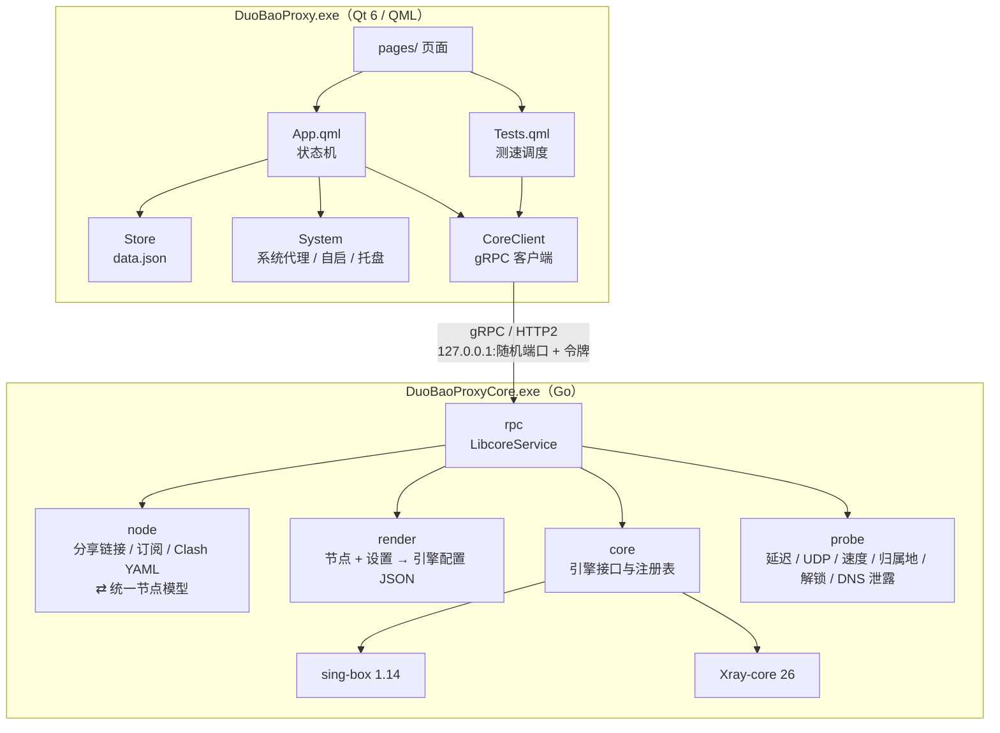

<a href="https://t.me/hyk857">关于开发者</a>

# 多宝代理 DuoBao Proxy · 产品架构

## 下载安装包

**[⬇ 下载 Windows 安装包（x64）](https://github.com/Smile96899/DuoBaoProxy/releases/latest)**

进入 Release 页面，下载 `DuoBaoProxy-<版本>-windows-x64-setup.exe` 直接运行即可，支持 Windows 10 / 11。可以用同一页面的 `SHA256SUMS.txt` 校验文件。安装包使用自签名证书，如果 SmartScreen 拦截，点「更多信息 → 仍要运行」。

## 总览

多宝代理由两个进程组成：Qt Quick 编写的界面 `DuoBaoProxy.exe`，和 Go 编写的核心 `DuoBaoProxyCore.exe`。两者通过本机 gRPC 通信。sing-box 和 xray 以库的形式编译进核心，不再单独启动进程。

## 设计原则

- **界面不懂协议**：界面只把节点当作 JSON 保存和展示；协议解析、配置生成、连接测试都在核心里完成。
- **核心与引擎解耦**：节点模型 `node.Node` 与具体引擎无关；每个引擎各有一个渲染器（`render/singbox`、`render/xray`），并实现同一个 `core.Core` 接口。新增引擎只需加一个渲染器和一个 `Core` 实现。
- **界面无状态地调用核心**：每次连接、测试、导出时，界面都会把节点和完整设置一起发给核心，核心不保存用户数据。

## 进程与通信

1. 界面启动时选一个空闲端口、生成随机令牌，以 `DuoBaoProxyCore run -port <端口> -token <令牌>` 启动核心。核心的工作目录设在数据目录。
2. gRPC 只监听 `127.0.0.1`。每次调用都要在元数据 `duobao_auth` 里带上令牌，否则会被拒绝（见 `go/rpc/auth.go`）。
3. 核心的日志一边写进 `core.log`，一边输出到 stderr。界面读取 stderr，翻译成中文后显示在「日志」页。
4. 界面退出时调用 `Exit`，核心随之结束。

gRPC 接口（`go/rpc/gen/libcore.proto`）：

| 接口 | 用途 |
| --- | --- |
| `ListCores` | 列出可用的引擎、版本和各自支持的协议 |
| `ImportNodes` / `ShareLink` | 文本 → 节点 / 节点 → 分享链接 |
| `RenderConfig` | 节点 + 设置 → 引擎配置。有三种模式：完整、测试、导出 |
| `Start` / `Stop` / `Status` | 启停引擎，查询状态 |
| `Test` | TCP 延迟、URL 延迟，以及各类探测 |
| `QueryStats` | 按出站标签查询上下行流量 |

## 主要流程

**连接**

1. `App.connect()` 调用 `RenderConfig`（节点、设置、完整模式），核心生成引擎配置和统计标签。
2. `Start`（引擎 id、配置、程序目录）：核心启动 sing-box 或 xray。
3. 系统代理模式下，`System` 设置系统代理；TUN 模式由 sing-box 自己接管网卡。
4. `CoreClient` 每秒轮询一次 `QueryStats`，计算实时网速。

设置改动后会防抖 800 ms，再自动重连生效。启动时如果发现系统代理还指向本机（上次异常退出留下的），会自动清除。

**导入**：剪贴板、二维码、订阅地址都由界面取到文本（订阅用 HTTP 下载，二维码由核心的 `qr` 子命令解析），再交给 `ImportNodes`。核心能识别单条或多条分享链接、Base64 订阅和 Clash / Clash.Meta YAML，结果由界面写入 Store。

**测试**：`Tests.qml` 负责排队和并发。URL 测试和探测会先用「测试模式」生成配置，核心据此创建一个**临时引擎实例**，通过它拨号；测完立即销毁，不影响正在使用的连接。

## 核心内部（`go/`）

| 包 | 职责 |
| --- | --- |
| `cmd/duobaoproxy-core` | 入口：`run` 启动 gRPC 服务；`qr` / `qr-encode` 解析和生成二维码；无参数时打印版本 |
| `rpc` | gRPC 服务实现、令牌校验，把调用分发到下面几个包 |
| `node` | 统一节点模型（14 种协议，以及传输层和 TLS 字段），负责分享链接、订阅、Clash YAML 的解析和导出 |
| `render` | 共用设置模型和规则解析（geosite: / geoip: / domain: / CIDR 等）；`singbox` 和 `xray` 子包各自生成对应引擎的配置 |
| `core` | `Core` 接口与注册表；`singbox`、`xray` 子包把引擎库封装成可启停、可拨号、可统计的实例 |
| `probe` | 延迟、丢包、UDP、上下行速度、出口归属地、流媒体 / AI 解锁、DNS 泄露检测 |

两个引擎的差异：

- sing-box：支持全部协议和 TUN；规则集（`.srs`）按需在线下载，缓存放在系统临时目录。
- xray：支持 V2Ray 系协议和 WireGuard；从程序目录读取 `geosite.dat` / `geoip.dat`。

界面通过 `ListCores` 拿到每个引擎支持的协议，据此决定哪些功能可用。

## 界面内部（`app/`）

| 位置 | 职责 |
| --- | --- |
| `src/core_client.*` | 启动并守护核心进程；封装 gRPC 调用，以信号形式把结果交给 QML；轮询流量 |
| `src/store.*` | 节点、分组、设置、界面状态的 JSON 持久化（`data.json`） |
| `src/system.*` | 系统代理（WinINet 注册表）、开机自启（Run 键）、托盘、剪贴板、管理员检测 |
| `qml/App.qml` | 单例状态机：连接 / 断开 / 重连、导入、分享 |
| `qml/Tests.qml` | 单例：测速任务的排队、并发与结果汇总 |
| `qml/Theme.qml` | 颜色、字体 token，深浅色主题 |
| `qml/Landscape.qml`、`qml/Portrait.qml` | 横屏和竖屏两套布局，共用 `pages/` 与 `components/` |

## 数据与文件

| 位置 | 内容 |
| --- | --- |
| 程序目录 | 两个 exe、Qt 运行库、VC++ 运行库、`geosite.dat` / `geoip.dat`（只读） |
| `%APPDATA%\DuoBao\DuoBaoProxy` | `data.json`（全部用户数据）、`core.log`、`gui.log` |
| `%TEMP%\duobaoproxy-singbox-cache.db` | sing-box 规则集和 FakeIP 缓存 |

## 构建与发布

| 脚本 | 产物 | 说明 |
| --- | --- | --- |
| `go/build_core.sh` | `DuoBaoProxyCore.exe` | 带 `with_utls`、`with_quic`、`with_wireguard`、`with_gvisor` 等 tag 编译 |
| `app/build.cmd` | `DuoBaoProxy.exe` | CMake + Ninja + MSVC |
| `app/package.ps1` | 安装包 | 编译上面两者 → windeployqt 组装 → 附加运行库和 geo 数据 → 签名（可选，`DBP_SIGN_CERT`）→ Inno Setup 打包 |

版本号取自 `app/CMakeLists.txt` 的 `project(... VERSION x.y)`，打包时注入界面、核心和安装包。exe 文件属性里的版本号写在 `app/res/app.rc`，需要另外手动修改。依赖安装和分步构建见 [app/README.md](app/README.md)。
